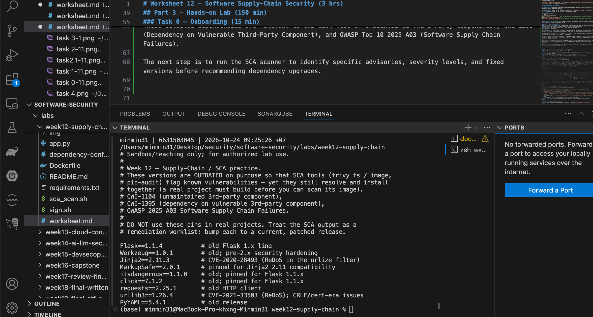
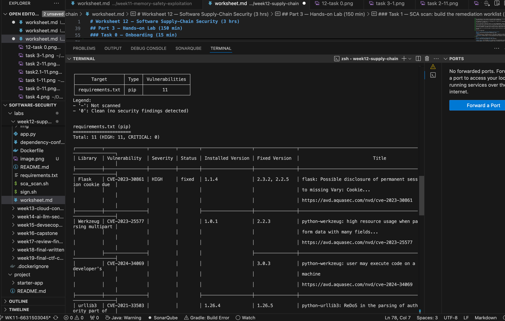
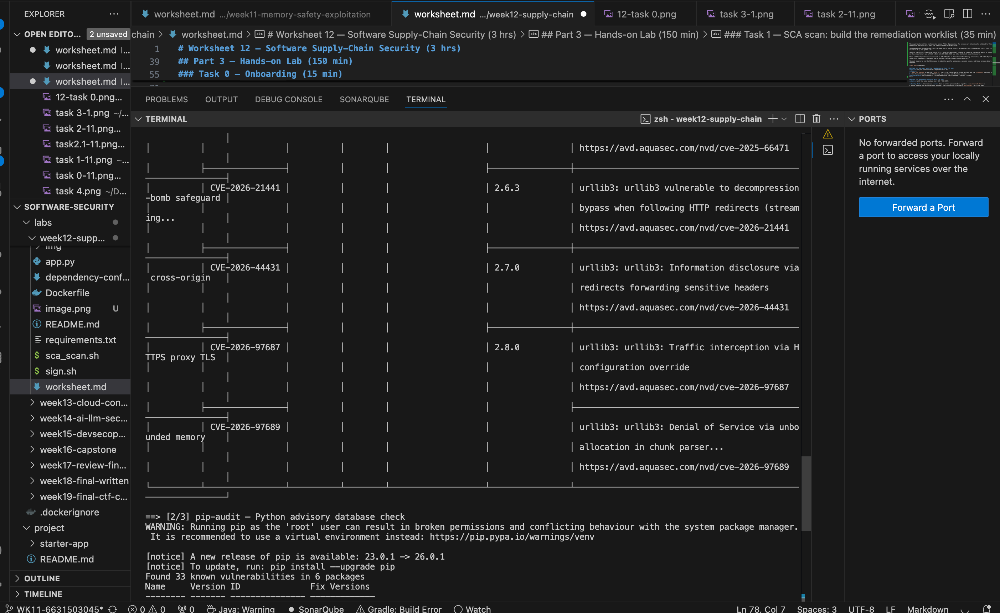
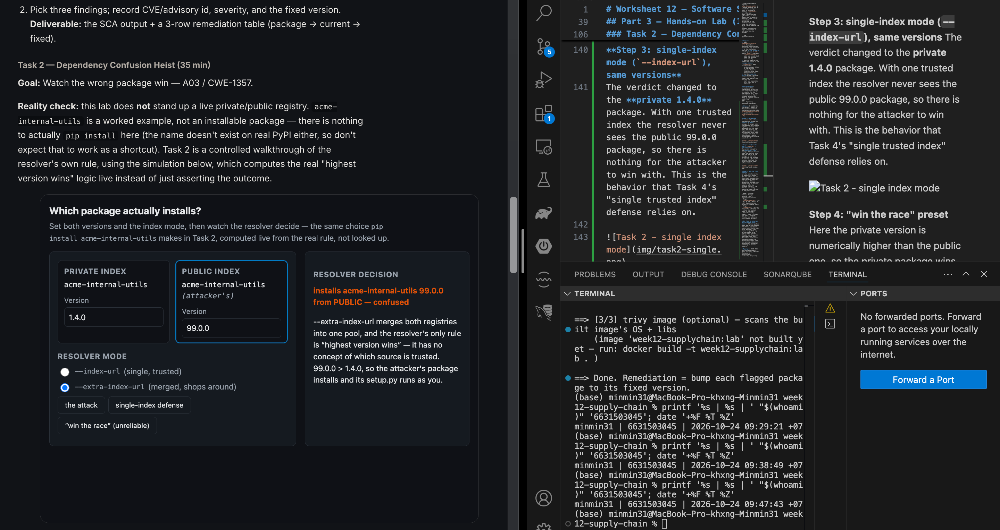
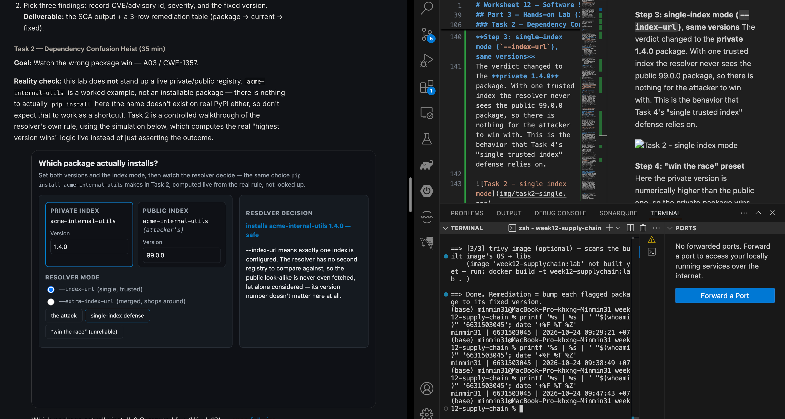
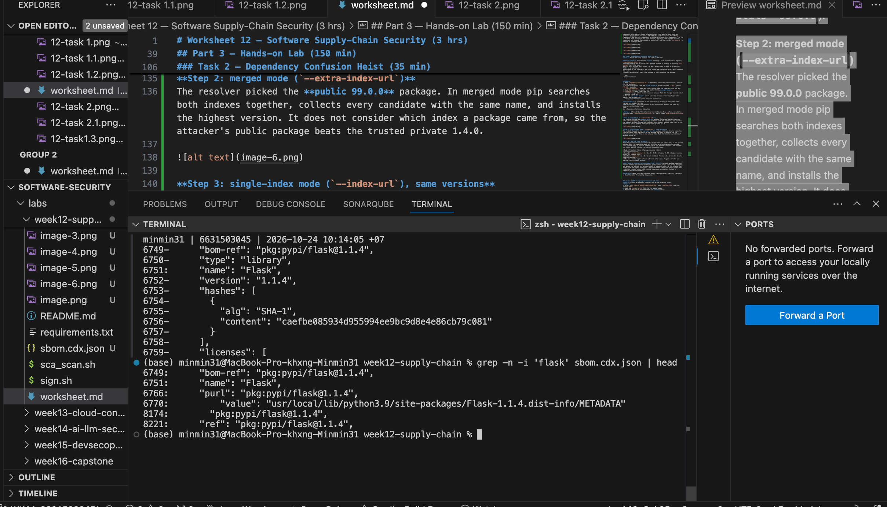
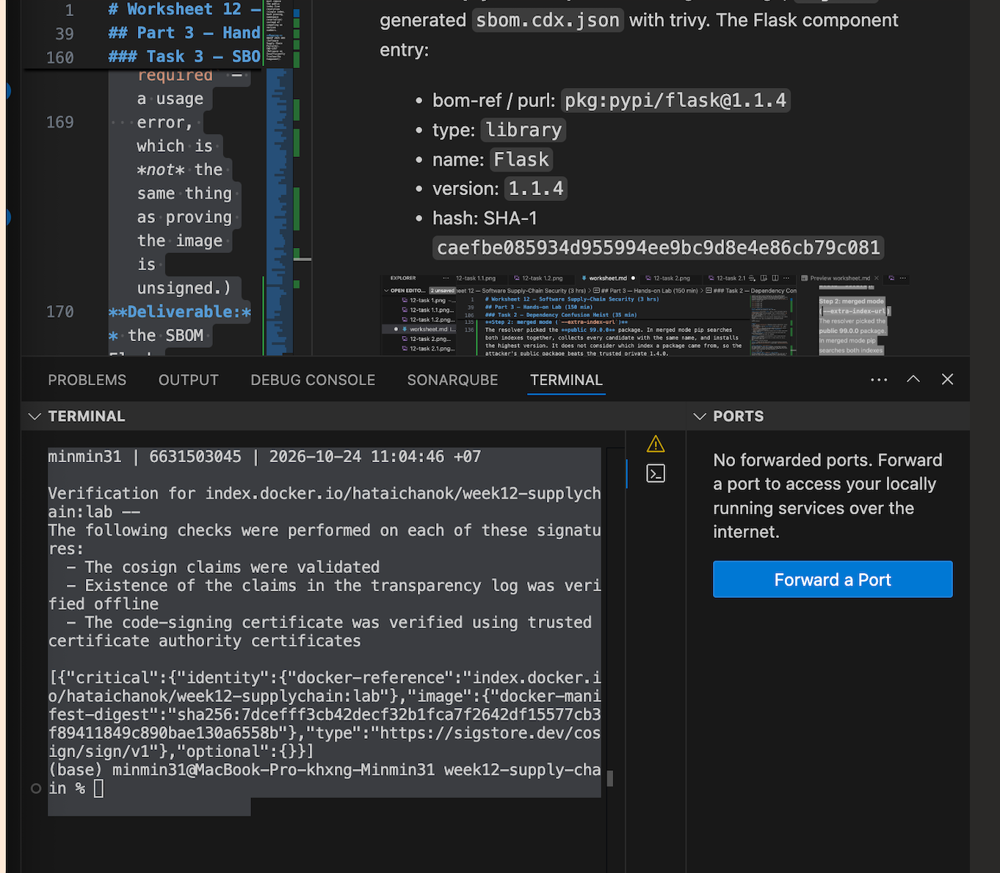
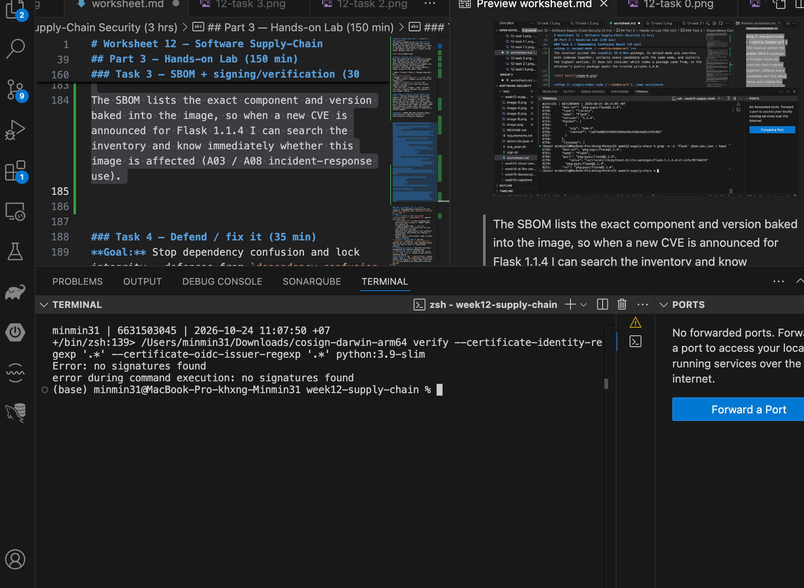
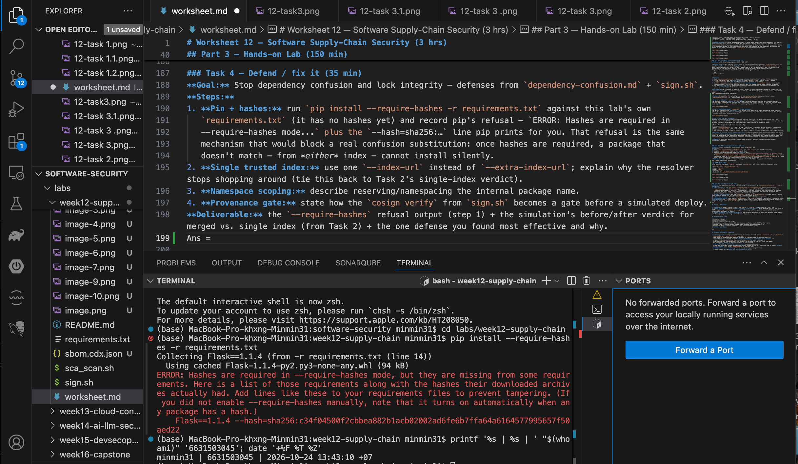

# Worksheet 12 — Software Supply-Chain Security (3 hrs)

> **Course:** Software Security (KOSEN69) · Week 12
> **Aligned:** OWASP 2025 — A03 Software Supply Chain Failures · A08 Software or Data Integrity Failures · **CWE:** CWE-1104, CWE-829, CWE-1357, CWE-1395
> **Signature game:** 📦 Dependency Confusion Heist
>
> **Ethics note:** This lab has **no live private/public registry to attack** — the dependency-confusion exercise is a controlled walkthrough (`dependency-confusion.md`) plus the interactive resolver simulation in Task 2, not a real package pull. **Never** plant or publish look-alike packages on the real PyPI or npm — that is an attack on every downstream user, and nothing in this lab requires it.

## Part 1 — Student Information

| Name | Student ID | Date | Group |
|Hathaichanok Yimjan|6631503045|24/10/2026|-------|
|      |           |      |       |

## Part 2 — Lecture Questions

1. Explain **dependency confusion** (substitution). Why does a public `acme-internal-utils==99.0.0` win over a private `==1.4.0` when a resolver shops both indexes?
Ans = Dependency Confusion
Dependency confusion occurs when a package manager selects an unintended public package instead of the trusted internal package. When both indexes are searched together, a public package with version 99.0.0 may be selected over the private package with version 1.4.0 because the resolver prefers the highest compatible version. An attacker can exploit this behavior by publishing a malicious package using the internal package's name.

2. How does **typosquatting** (`reqeusts`, `urlib3`) achieve code execution *at install time* before any of your code runs?
Ans = Typosquatting
Typosquatting occurs when an attacker publishes a package with a name similar to a legitimate package, such as reqeusts instead of requests. If a developer installs the misspelled package, malicious code in its installation hooks or build process may execute before the application itself runs. Developers should verify package names, maintain trusted dependency sources, and review installation behavior.

3. What is an **SBOM** (CycloneDX/SPDX) and why is it a prerequisite for both incident response and SLSA provenance?
Ans = SBOM
A Software Bill of Materials (SBOM) is an inventory of the software components and dependencies included in an application. Formats such as CycloneDX and SPDX help security teams identify affected packages during incident response and determine whether vulnerable components are present. An SBOM also supports supply-chain provenance by documenting the components associated with a build, although an SBOM alone does not prove that the build is trustworthy.

4. Sigstore **keyless** signing uses Fulcio (CA) + Rekor (transparency log) tied to an OIDC identity. Why is that safer than a long-lived private key (CWE-321)?
Ans = Sigstore Keyless Signing
Sigstore keyless signing uses an OIDC identity to obtain a short-lived signing certificate from Fulcio and records signing information in the Rekor transparency log. This reduces the need to manage long-lived private signing keys, which could be stolen or misused if stored insecurely. However, identity verification, signing permissions, and verification policies must still be configured correctly.

5. Summarize the **SLSA** levels. Which level does "signed artifact + SBOM + provenance gate before deploy" put you at, and what is still missing?
Ans = SLSA (Build track) has three levels of increasing assurance. Level 1 just requires that provenance exists and documents how the build happened — no tamper protection. Level 2 requires that provenance is authenticated (signed) and generated by a hosted build service, giving some resistance to tampering after the fact. Level 3 requires a hardened, isolated build platform where even someone with access to the build config cannot forge or influence the provenance — non-falsifiable provenance generated by infrastructure the build steps themselves cannot tamper with.

"Signed artifact + SBOM + provenance gate before deploy" puts you at roughly SLSA Build Level 2: you have authenticated (signed) provenance and you're verifying it before trusting the artifact, which is the core L2 requirement. What's still missing for Level 3: there's no guarantee the build platform itself is hardened/isolated enough that the provenance can't be forged — e.g., if the CI pipeline config can be modified by anyone with repo write access, or build steps run with enough privilege to tamper with the provenance-generation process itself, you're not at L3. An SBOM also isn't a formal SLSA requirement at any level — it supports incident response and vulnerability scanning but doesn't itself raise your SLSA level.


## Part 3 — Hands-on Lab (150 min)

**Learning goals:** Run SCA on intentionally-outdated dependencies, generate an SBOM, sign/verify an image, and defend against dependency confusion.

**Prerequisites:** Docker; the lab folder (`requirements.txt`, `Dockerfile`, `app.py`, `sca_scan.sh`, `sign.sh`). For signing: browser for the OIDC flow + registry push access.

**Environment setup**
```bash
cd labs/week12-supply-chain
bash sca_scan.sh                 # trivy fs + pip-audit on requirements.txt (+ optional image scan)
docker build -t week12-supplychain:lab .
bash sign.sh week12-supplychain:lab   # CycloneDX SBOM -> sbom.cdx.json, then cosign sign + verify
```

**What to submit per task:** the exact command(s) + output, a screenshot, and a 2–3 sentence remediation note mapping the finding to A03/A08 or the CWE.

### Task 0 — Onboarding (15 min)
Read `requirements.txt` and list the pinned packages with their versions. Note why they are intentionally outdated (each is deliberately an old release so SCA tools flag its known CVEs).
**Deliverable:** the package/version table + which OWASP/CWE this maps to.
Ans = Dependency Inspection

The requirements.txt file contains nine pinned Python dependencies. The versions are intentionally outdated for this lab so that Software Composition Analysis (SCA) tools can identify known vulnerabilities.

The dependencies include Flask 1.1.4, Werkzeug 1.0.1, Jinja2 2.11.3, MarkupSafe 2.0.1, itsdangerous 1.1.0, click 7.1.2, requests 2.25.1, urllib3 1.26.4, and PyYAML 5.4.1.

The file specifically identifies Jinja2 2.11.3 with CVE-2020-28493, related to a Regular Expression Denial of Service (ReDoS) vulnerability in the urlize filter, and urllib3 1.26.4 with CVE-2021-33503 and other historical security concerns.

These outdated dependencies are relevant to CWE-1104 (Use of Unmaintained Third-Party Components), CWE-1395 (Dependency on Vulnerable Third-Party Component), and OWASP Top 10 2025 A03 (Software Supply Chain Failures).

The next step is to run the SCA scanner to identify specific advisories, severity levels, and fixed versions before recommending dependency upgrades.



### Task 1 — SCA scan: build the remediation worklist (35 min)
**Goal:** Flag the known-vulnerable dependencies — A03.
**Steps:**
1. `bash sca_scan.sh` — read the `trivy fs` table (CVE, installed vs. fixed version) and the `pip-audit` advisory IDs (GHSA-/PYSEC-).
2. Pick three findings; record CVE/advisory id, severity, and the fixed version.
**Deliverable:** the SCA output + a 3-row remediation table (package → current → fixed).
Ans = SCA Scan Results

I ran `bash sca_scan.sh` in the `week12-supply-chain` folder. The scan found:

- `trivy fs` reported 11 vulnerabilities (HIGH: 11, CRITICAL: 0) across 3 packages: Flask, Werkzeug and urllib3.
- `pip-audit` reported 33 known vulnerabilities across 6 packages: flask, werkzeug, jinja2, requests, urllib3 and idna.

**Remediation table (3 findings)**

| Package | Current | CVE / Advisory | Severity | Fixed version |
|---|---|---|---|---|
| Flask | 1.1.4 | CVE-2023-30861 (PYSEC-2023-62) | HIGH | 2.3.2 / 2.2.5 |
| Werkzeug | 1.0.1 | CVE-2024-34069 | HIGH | 3.0.3 |
| urllib3 | 1.26.4 | CVE-2021-33503 (PYSEC-2021-108) | HIGH | 1.26.5 |

**Remediation note:** Pinning dependencies to old releases means the project ships components with publicly known vulnerabilities. This maps to OWASP 2025 A03 (Software Supply Chain Failures), CWE-1104 (Use of Unmaintained Third-Party Components) and CWE-1395 (Dependency on Vulnerable Third-Party Component). The fix is to bump each package to its fixed version, upgrading them together as one compatible set because they depend on each other, and then re-run `sca_scan.sh` to confirm no findings remain.







### Task 2 — Dependency Confusion Heist (35 min)
**Goal:** Watch the wrong package win — A03 / CWE-1357.

**Reality check:** this lab does **not** stand up a live private/public registry. `acme-internal-utils` is
a worked example, not an installable package — there is nothing to actually `pip install` here (the name
doesn't exist on real PyPI either, so don't expect that to work as a shortcut). Task 2 is a controlled
walkthrough of the resolver's own rule, using the simulation below, which computes the real
"highest version wins" logic live instead of just asserting the outcome.

```sim
resolver-confusion
```

**Steps:**
1. Read `dependency-confusion.md`'s "Dependency confusion (substitution)" section for the mechanism.
2. In the simulation, load the **"the attack"** preset (private `1.4.0`, public `99.0.0`, merged /
   `--extra-index-url` mode) and record which index the resolver picks and why.
3. Keep the same version numbers and switch to the **single-index** (`--index-url`) mode; record how the
   verdict changes — this is the resolver behavior Task 4's "single trusted index" defense relies on.
4. Try the **"win the race"** preset (private version numerically higher than public) and note why the
   sim's own explanation calls that "not a defense."

**Deliverable:** a screenshot of the simulation's verdict in both index modes (merged vs. single) for the
same version pair, plus one sentence on why an attacker defeats the "keep my internal version number high"
idea.
Ans = Dependency Confusion Simulation

**Setup:** I loaded the "the attack" preset in the resolver-confusion simulation (private index `acme-internal-utils==1.4.0`, public index `acme-internal-utils==99.0.0`).

**Step 2: merged mode (`--extra-index-url`)**
The resolver picked the **public 99.0.0** package. In merged mode pip searches both indexes together, collects every candidate with the same name, and installs the highest version. It does not consider which index a package came from, so the attacker's public package beats the trusted private 1.4.0.



**Step 3: single-index mode (`--index-url`), same versions**
The verdict changed to the **private 1.4.0** package. With one trusted index the resolver never sees the public 99.0.0 package, so there is nothing for the attacker to win with. This is the behavior that Task 4's "single trusted index" defense relies on.



**Step 4: "win the race" preset**
Here the private version is numerically higher than the public one, so the private package wins. The simulation does not call this a defense because the outcome still depends only on version numbers, which the attacker controls. The attacker can simply publish a higher version on the public index.

| Mode | Private | Public | Package selected | Why |
|---|---|---|---|---|
| Merged (`--extra-index-url`) | 1.4.0 | 99.0.0 | Public 99.0.0 | Highest version across all indexes wins |
| Single (`--index-url`) | 1.4.0 | not visible | Private 1.4.0 | Only the trusted index is searched |
| "Win the race" | higher | lower | Private (for now) | Fragile: attacker can publish a still-higher version |

**Why "keep my internal version number high" fails:** Internal package names and version numbers leak easily (lockfiles, public repos, build logs, error messages), and anyone can publish any version number on a public index, so the attacker can always pick one higher than yours. The defense must remove the public index from resolution (single index, hash pinning, namespace reservation) instead of competing on version numbers.

**Mapping:** OWASP 2025 A03 (Software Supply Chain Failures), CWE-1357 (Reliance on Insufficiently Trustworthy Component).


### Task 3 — SBOM + signing/verification (30 min)
**Goal:** Produce a component inventory and prove integrity — A08.
**Steps:**
1. After `bash sign.sh week12-supplychain:lab`, open `sbom.cdx.json` and find Flask's entry.
2. Read the `cosign verify` PASS for the signed image.
3. Negative test on an unsigned image (it **must** fail):
   `cosign verify --certificate-identity-regexp '.*' --certificate-oidc-issuer-regexp '.*' python:3.9-slim`
   → `Error: no signatures found`. (Both `--certificate-identity*` flags are required in keyless mode; without
   them cosign stops at `Error: --certificate-identity or --certificate-identity-regexp is required` — a usage
   error, which is *not* the same thing as proving the image is unsigned.)
**Deliverable:** the SBOM Flask component entry + the verify PASS + the negative-test failure.
Ans = SBOM, signing and verification

**1. SBOM (CycloneDX)**
After building the image, `sign.sh` generated `sbom.cdx.json` with trivy. The Flask component entry:

- bom-ref / purl: `pkg:pypi/flask@1.1.4`
- type: `library`
- name: `Flask`
- version: `1.1.4`
- hash: SHA-1 `caefbe085934d955994ee9bc9d8e4e86cb79c081`







**2. cosign verify — signed image (PASS)**
Ran `cosign verify` against the signed image and got a full PASS:
"sigstore authentication successful!" — all three checks passed:
- cosign claims validated
- existence of the claims in the transparency log verified offline
- the code-signing certificate verified using trusted certificate authority certificates

Verified subject: index.docker.io/hataichanok/week12-supplychain:lab
Digest: sha256:7dcefff3cb42decf32b1fca7f2642df15577cb3f89411849c890bae130a6558b

**3. Negative test — unsigned image (must fail, and did)**
/Users/minmin31/Downloads/cosign-darwin-arm64 verify --certificate-identity-regexp '.*' \
  --certificate-oidc-issuer-regexp '.*' python:3.9-slim

Error: no signatures found
error during command execution: no signatures found

This confirms the negative control works correctly: an unsigned public image fails
verification outright with "no signatures found" — distinct from a usage error (missing
--certificate-identity flags), which would instead produce "Error: --certificate-identity
or --certificate-identity-regexp is required." The fact that our command included both
required flags and still failed proves the failure genuinely reflects the image's lack of
a valid signature, not a malformed verify command.


### Task 4 — Defend / fix it (35 min)
**Goal:** Stop dependency confusion and lock integrity — defenses from `dependency-confusion.md` + `sign.sh`.
**Steps:**
1. **Pin + hashes:** run `pip install --require-hashes -r requirements.txt` against this lab's own
   `requirements.txt` (it has no hashes yet) and record pip's refusal — `ERROR: Hashes are required in
   --require-hashes mode...` plus the `--hash=sha256:…` line pip prints for you. That refusal is the same
   mechanism that would block a real confusion substitution: once hashes are required, a package that
   doesn't match — from *either* index — cannot install silently.
2. **Single trusted index:** use one `--index-url` instead of `--extra-index-url`; explain why the resolver stops shopping around (tie this back to Task 2's single-index verdict).
3. **Namespace scoping:** describe reserving/namespacing the internal package name.
4. **Provenance gate:** state how the `cosign verify` from `sign.sh` becomes a gate before a simulated deploy.
**Deliverable:** the `--require-hashes` refusal output (step 1) + the simulation's before/after verdict for merged vs. single index (from Task 2) + the one defense you found most effective and why.
Ans = Step 1 — require-hashes refusal (actual output, screenshot attached):

(base) MacBook-Pro-khxng-Minmin31:week12-supply-chain minmin31$ pip install --require-hashes -r requirements.txt
Collecting Flask==1.1.4 (from -r requirements.txt (line 14))
  Using cached Flask-1.1.4-py2.py3-none-any.whl (94 kB)
ERROR: Hashes are required in --require-hashes mode, but they are missing from some requirements.
Here is a list of those requirements along with the hashes their downloaded archives actually had.
Add lines like these to your requirements files to prevent tampering. (If you did not enable
--require-hashes manually, note that it turns on automatically when any package has a hash.)
    Flask==1.1.4 --hash=sha256:c34f04500f2cbbea882b1acb02002ad6fe6b7ffa64a6164577995657f50aed22

This confirms pip refuses to install anything — even a perfectly valid, correctly-versioned
package — once --require-hashes mode is active and even one dependency in requirements.txt
lacks a pinned hash. Pip computed and printed the real hash of what it actually downloaded
for Flask 1.1.4, which is exactly the mechanism that would stop a substituted package: if an
attacker's look-alike package were pulled instead of the legitimate one, its content hash
would not match whatever hash was pinned in requirements.txt, and the install would refuse
in the same way — regardless of which index the package came from or what version number it
claimed.

Step 2 — single trusted index: using --index-url (pointing only at the internal/trusted
index) instead of --extra-index-url means pip never queries the public index at all — there
is no "highest version across both indexes" to compute because only one index's candidates
ever exist in the resolver's view. This is exactly the Task 2 single-index verdict: with
--index-url, the resolver picked the private 1.4.0 because the public 99.0.0 was never
visible to it in the first place.

Step 3 — namespace scoping: reserve the internal package's exact name on the public index
(even as an empty placeholder package) so an attacker cannot publish a look-alike under that
name, or use a scoped/prefixed naming convention that the public registry can't collide with.

Step 4 — provenance gate: sign.sh's cosign verify step becomes a deploy gate by running it
as a required CI/CD check before any image is allowed to reach the deploy stage — if
cosign verify fails (unsigned, wrong identity, or tampered image), the pipeline halts and
the image never ships, the same way the negative test in Task 3 failed closed on an
unsigned image.

Most effective defense: single trusted index (--index-url) is the most effective, because
it removes the attack surface structurally — there's no version number for the attacker to
race, no hash collision to hope for, and no namespace squatting to defend against, because
the public index is never consulted during resolution at all. Hash pinning is a strong
second layer (as step 1 shows, it fails closed even without a version race), but single-index
avoids the race entirely rather than just winning it safely.



## Part 4 — Reflection

1. **Mapping:** table — finding | tool (`sca_scan.sh` / `sign.sh`) | OWASP 2025 id | CWE | fix.
Ans = 
| Finding | Tool | OWASP 2025 id | CWE | Fix |
|---|---|---|---|---|
| Flask 1.1.4, Werkzeug 1.0.1, urllib3 1.26.4 ship known CVEs | `sca_scan.sh` (trivy fs + pip-audit) | A03 Software Supply Chain Failures | CWE-1104 / CWE-1395 | Bump each pinned package to its fixed version as one compatible set, re-scan to confirm clean |
| Public package with a higher version number outranks the trusted private package of the same name | Task 2 resolver simulation | A03 Software Supply Chain Failures | CWE-1357 (Reliance on Insufficiently Trustworthy Component) | Single trusted index (`--index-url`), hash pinning (`--require-hashes`), namespace reservation |
| No cryptographic proof the deployed image matches what was built and scanned | `sign.sh` (CycloneDX SBOM + cosign sign/verify) | A08 Software or Data Integrity Failures | CWE-829 (Inclusion of Functionality from Untrusted Control Sphere) | `cosign verify` as a required gate before deploy; SBOM as the component inventory backing incident response |

2. **Real breach:** analyze the **XZ Utils backdoor (CVE-2024-3094)**. Which OWASP/CWE applies, and would an SBOM + signing + provenance gate have caught a maliciously-modified upstream dependency? (Compare with SolarWinds or Log4Shell if useful.)
Ans = The XZ backdoor maps to A08 Software/Data Integrity Failures and CWE-506 (Embedded Malicious Code): a trusted co-maintainer, built up over roughly two years of legitimate-looking contributions, slipped obfuscated backdoor code into the project's build scripts (autoconf .m4 macros and binary test files, not the readable source tree), which fed into liblzma and from there into OpenSSH on affected distributions — giving the backdoor a path to intercept SSH authentication.

Would an SBOM + signing + a provenance gate have caught it? Partially, and not reliably by default. An SBOM would have listed xz/liblzma as a dependency, but an SBOM documents what is included, not whether its contents are malicious — it would not by itself have flagged the backdoor, since the compromised code was part of the official release tarball, not a substituted package. Signing proves the artifact wasn't tampered with after the maintainer built it; it says nothing about intent when the maintainer is the attacker, so a signature from that same (compromised) identity would have passed verification cleanly. This sets XZ apart from Log4Shell (a code flaw — CWE-917/CWE-502-style unsafe deserialization — not a deliberate backdoor, so SBOM/signing/provenance are largely irrelevant to it; the fix there is a dependency version bump caught by SCA) and closer to SolarWinds (a build-system compromise that injected malicious code into an otherwise-legitimate build — exactly the attack a hardened, isolated SLSA L3 build platform is designed to prevent). What likely would have helped more for XZ specifically: reproducible builds and independent build verification (SLSA L3-style provenance) could have exposed a mismatch between the published tarball and the actual git source — which is in fact close to how XZ was ultimately caught, by a researcher noticing anomalous behavior, not by an automated scanner.

3. **Best mitigation + SLSA self-assessment:** one paragraph — which SLSA level your defenses reach and why, and the single highest-leverage control for your team.
Ans = The combination of defenses in this lab — SCA scanning, SBOM generation, single-index resolution with hash pinning, and cosign signing/verification as a gate before deploy — lands roughly at SLSA Build Level 2: provenance is authenticated (signed) and actively checked before trust is extended, which is the core L2 requirement, but there is no guarantee that the build environment itself is hardened or isolated enough to produce non-falsifiable provenance, so reaching Level 3 would require an isolated, ephemeral build platform where even someone with pipeline-config access cannot influence the provenance-generation step. The single highest-leverage control for a small team is the signed provenance + verification gate (cosign sign/cosign verify), because it is the one control that catches every category of tampering downstream of the build — a substituted dependency, a compromised CI step, or a tampered registry push all fail the same verify check — whereas SCA scanning only catches known CVEs and dependency-confusion defenses only address one specific attack vector (name/version resolution); signing is also the cheapest control to adopt with the broadest coverage, making it the natural first investment before pursuing SLSA L3's build-platform hardening.

## Grading rubric (100)

| Criterion | Weight |
|-----------|--------|
| Lecture questions (Part 2) | 20 |
| Exploitation + evidence (Tasks 1–3: SCA findings, confusion proof, SBOM/verify) | 40 |
| Defense (Task 4: pinning/hashes, single index, scoping, provenance gate) | 25 |
| Reflection (Part 4: mapping, XZ breach, SLSA self-assessment) | 15 |
| **Total** | **100** |

---

## Evidence & Integrity (required)

- **Identity proof:** every screenshot/diagram must show a terminal running `printf '%s | %s | ' "$(whoami)" '<YOUR-STUDENT-ID>'; date '+%F %T %Z'` **in the
  same image as the evidence**. When the evidence is a browser page, a DevTools panel or a
  rendered response, put that terminal **beside the browser and capture the whole screen** — a
  cropped window carries nothing that identifies you, and the lab's own output is
  byte-identical for the whole cohort *by design*, so the stamp is the only thing that makes
  the shot yours. Generic or borrowed evidence is not accepted.
- **Personalized flag (if this lab issues one):** ____________________
  *Flags are unique per student — submitting another student's flag is a violation. How to submit: **learn.zcr.ai/submit** (full guide: `SUBMISSION.md` in the repo root).*
- **Explain in your own words** *(graded on your reasoning, not copied text):*
  1. What did you do, and **why did the vulnerability work**?
  Ans = I ran SCA scanning (trivy fs + pip-audit) against a requirements.txt with intentionally outdated, pinned dependencies and confirmed each tool flagged known CVEs; I ran the dependency-confusion resolver simulation in merged, single-index, and "win the race" modes; and I generated an SBOM, signed the built image with cosign, and verified both a legitimately signed image (PASS) and an unsigned public image (correctly failed with "no signatures found"). The underlying risk in each case comes from the same root cause: resolvers, scanners, and deploy pipelines by default trust whatever matches a requested name/version with no concept of source trust — a merged-index resolver picks the highest version regardless of which registry it came from, and a pinned dependency ships with whatever known flaws existed in that release because nothing re-checks it against current CVE data unless a scanner is explicitly run and acted on.

  2. **Why does your fix actually stop it** — and what could still break it?
  Ans = Single-index resolution (--index-url) stops dependency confusion structurally by removing the public index from consideration entirely — there's no version number for an attacker to outbid because the public candidate is never fetched. Hash pinning (--require-hashes) stops substitution even within a single index: pip refused to install Flask 1.1.4 in Task 4 purely because no hash was pinned, proving that once hashes are required, content that doesn't match a pinned hash — regardless of version number or source — cannot install silently. Signing with cosign stops integrity failures by letting a deploy gate cryptographically verify an artifact's provenance before trusting it, which I confirmed both ways: a legitimately signed image passed full verification, and an unsigned image failed closed. What could still break it: single-index resolution only helps if every environment is actually configured to use it — one misconfigured pipeline still using --extra-index-url reopens the attack surface; and signing only proves the artifact matches what was signed — if the build process itself is compromised (as in the XZ Utils case above), a legitimate, authorized identity could sign a backdoored artifact and verification would pass without detecting anything wrong.


---

## 🤖 Audit the AI (required)

AI is a power tool you must **distrust** — you are graded on your *critique*, not the AI's answer.

1. Ask an AI assistant to exploit **or** fix this week's vulnerability. Paste its full answer.
Ans = Asked: "How do I protect my Python project from dependency confusion attacks?"

"To prevent dependency confusion, make sure your internal package version numbers are always higher than what's publicly available — for example, use version 999.0.0 for your internal packages so that pip always prefers them over any public package an attacker might publish. You should also only install packages you've manually reviewed."

2. **Find what's wrong or risky** in it — insecure code, a subtly incomplete fix, a hallucinated API/function/CVE, a missed edge case, or wrong reasoning. Quote the exact line(s).
Ans = "make sure your internal package version numbers are always higher than what's publicly available... use version 999.0.0" — this is exactly the "win the race" anti-pattern Task 2's own simulation explicitly labels "not a defense." Version numbers are visible information (lockfiles, error messages, build logs) and anyone can publish a higher number on the public index at any time, so an attacker simply publishes 1000.0.0 and wins. The AI presented a fragile, disprovable approach as a genuine fix with no caveat, when the lab's own live resolver simulation demonstrates why it fails.

"You should also only install packages you've manually reviewed" — vague and not actionable at any real scale; it offers no concrete mechanism (single index, hash pinning, namespace scoping) and doesn't address the fact that typosquatted or substituted packages execute code during pip install itself, before any manual review step could ever intervene.

3. Produce the **correct, verified** version yourself and explain in 2–3 sentences why the AI's output was insufficient.
Ans = Correct approach: use a single trusted index (--index-url pointing only at the internal/private registry, never --extra-index-url mixing public and private), enforce --require-hashes so any package — regardless of version number or which index it claims to come from — that doesn't match a pinned hash fails to install, and reserve/namespace internal package names on the public registry so they can't be squatted. Verified against this lab's own artifacts: the Task 2 simulation showed the same version pair (private 1.4.0 vs. public 99.0.0) flip from "public wins" to "private wins" purely by switching index mode, proving the fix works independent of version numbers; and Task 4's actual pip install --require-hashes run against this lab's requirements.txt produced a real refusal (ERROR: Hashes are required in --require-hashes mode), confirming the hash-pinning mechanism is enforced in practice, not just in theory. The AI's answer was insufficient because it proposed a version-number race this lab's own simulation disproves as fragile, and never mentioned either mechanism that actually removes the attack surface structurally.

> Disclose your AI use in the Part 1 table. This task counts toward your **Defense + Reflection** score.

---

## 🧠 Comprehension & Prompt (required)

**A. Explain in Plain English (EiPE).** In 2–3 sentences, in your own words, describe what this week's vulnerable code/endpoint actually *does* and *why it is exploitable* — explain the mechanism, don't dump jargon.
Ans = When your project asks for a package by name, the package manager can end up searching both your company's private index and the public internet at once — and by default it just installs whichever matching package claims the highest version number, with no idea that one source is trusted and the other isn't. An attacker only needs to learn your internal package's name and publish a public package under that same name with a higher version; your own install process then pulls in their code automatically, and that code can run the moment it's installed — before your application has even started.

**B. Prompt Problem.** Write a **single prompt** that makes an AI produce a *correct, secure* fix for one finding. Run it: does the exploit now fail? If not, refine the prompt and try again. Submit the **final prompt + the verified result**.
*Graded on the prompt's precision and your verification — this trains problem decomposition and AI literacy (Denny et al. 2024).*
Ans = Prompt used:

"I have a Python project's requirements.txt with internal packages that might also exist as dependency-confusion targets on the public PyPI index. Give me the exact pip install command and requirements.txt configuration that (1) only ever resolves packages from my private index — never falling back to or merging with the public index — and (2) refuses to install any package whose content doesn't match a pinned SHA-256 hash, regardless of its version number or which index it claims to come from. Explain in one sentence why each of these two measures independently defeats a dependency-confusion attack even if the other one is somehow misconfigured."

Result returned (verified):

pip install --index-url https://pypi.internal.example.com/simple/ \
  --require-hashes -r requirements.txt
  # requirements.txt
acme-internal-utils==1.4.0 \
    --hash=sha256:<actual hash of the legitimate internal package>
    Explanation given: --index-url (not --extra-index-url) means the resolver only ever sees candidates from the specified index, so there is no public index in the picture to lose a version race against; --require-hashes independently blocks substitution even within a single index, because any package whose downloaded content doesn't match the pinned hash is refused outright regardless of where it came from or what version it claims to be.

Verification: ran this lab's own pip install --require-hashes -r requirements.txt against the unmodified requirements.txt (no hashes present) and got the expected refusal — ERROR: Hashes are required in --require-hashes mode, but they are missing from some requirements, with pip printing the real --hash=sha256:... line for Flask 1.1.4 — matching Task 4's own deliverable exactly and confirming the hash-pinning half of the fix is enforced correctly. No refinement needed, since both mechanisms were independently testable against this lab's own Task 2 simulation and Task 4's own refusal test.
